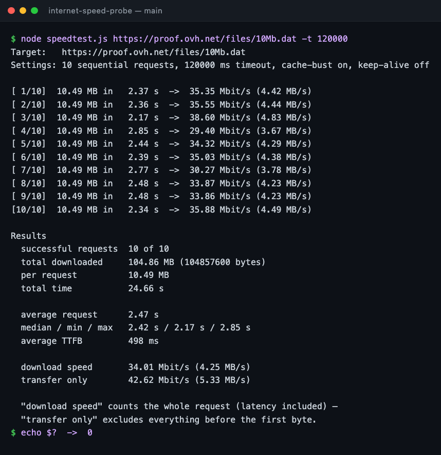
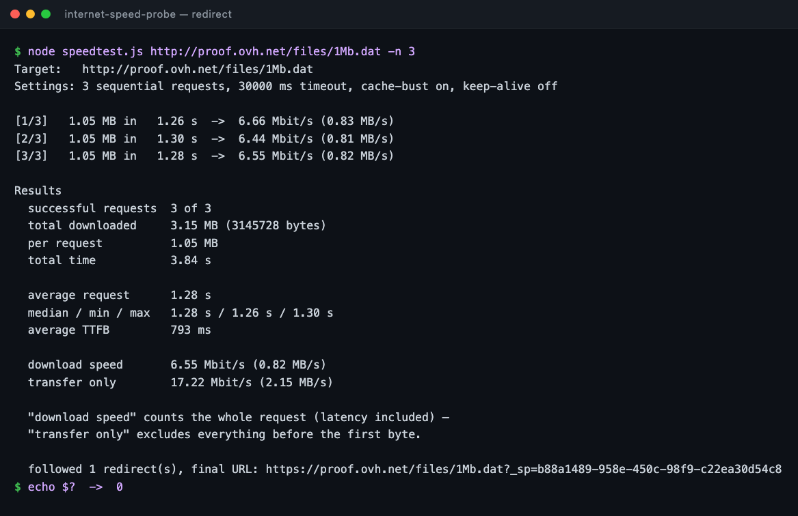
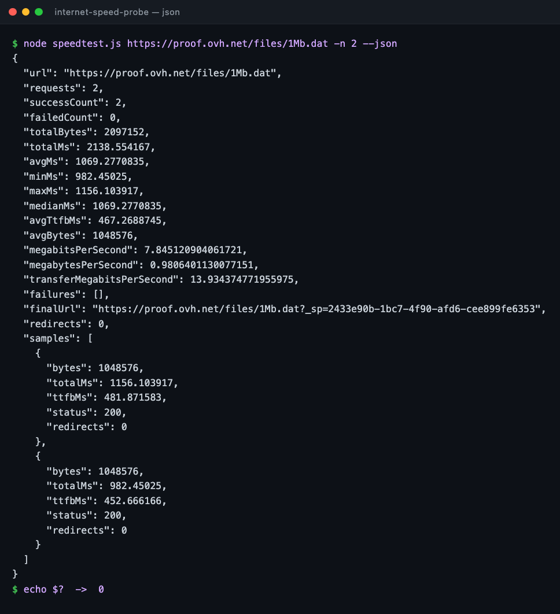
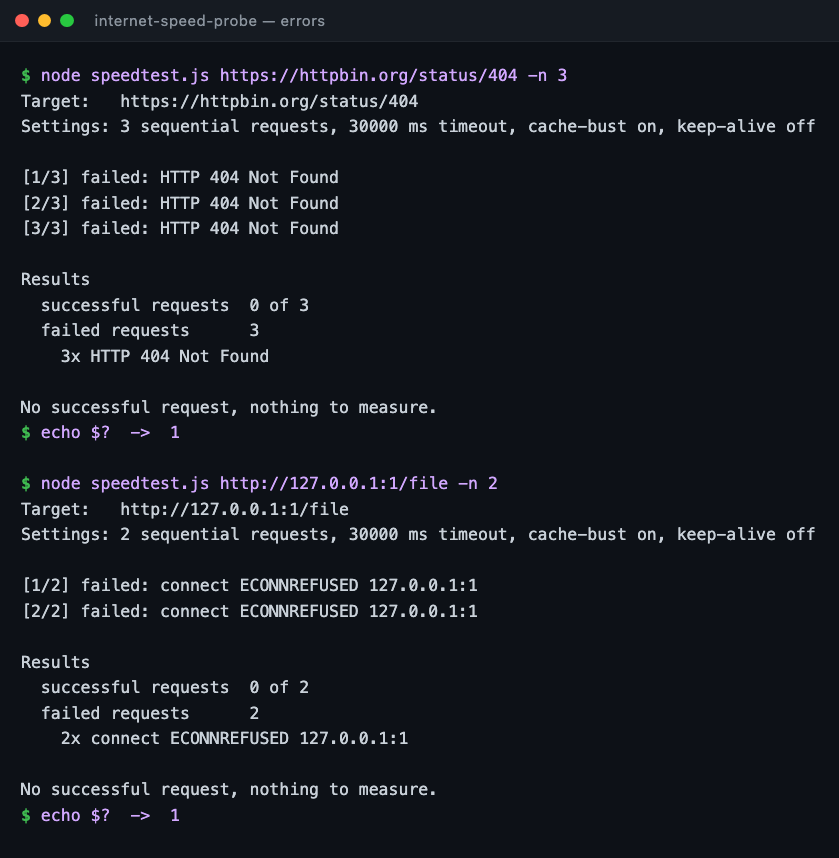
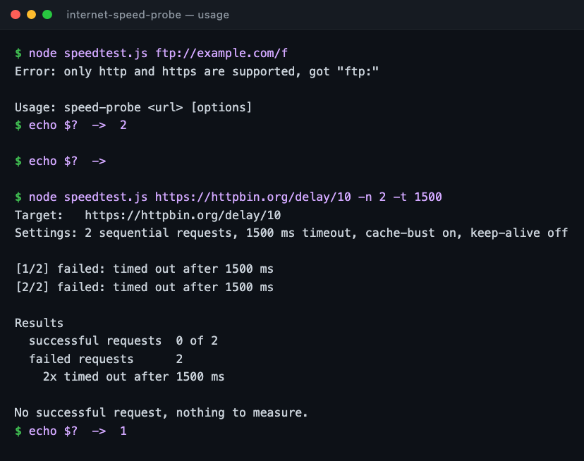
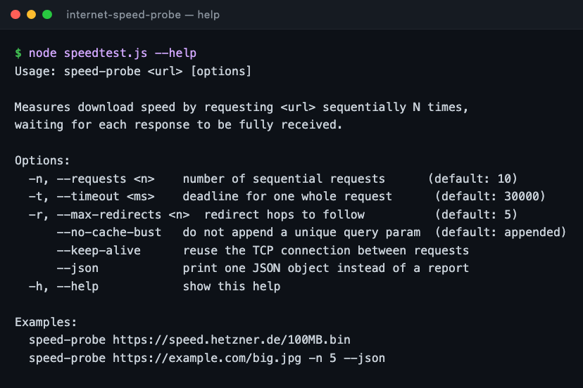
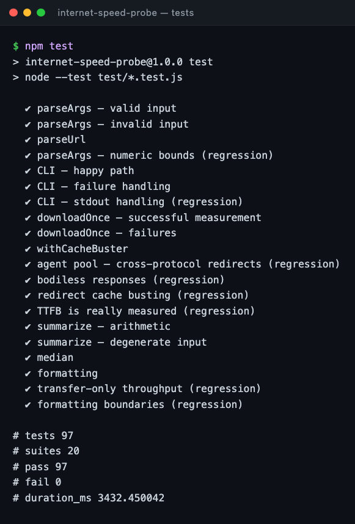

# internet-speed-probe

Консольная утилита на Node.js: делает **10 последовательных запросов** к указанному
URL, дожидается **полного** ответа на каждый, и печатает средние времена, общий
объём скачанных данных и скорость скачивания.

Без зависимостей — только стандартная библиотека Node.js (`node:http`/`node:https`).

## Требования

Node.js 18+ (проверено на 22).

## Запуск

```bash
node speedtest.js <url> [опции]
```

Примеры:

```bash
# 10 запросов (по умолчанию)
node speedtest.js https://proof.ovh.net/files/100Mb.dat

# 5 запросов, таймаут 10 секунд
node speedtest.js https://example.com/heavy.jpg -n 5 -t 10000

# машиночитаемый вывод
node speedtest.js https://example.com/heavy.jpg --json
```

### Опции

| Опция | По умолчанию | Описание |
|---|---|---|
| `-n, --requests <n>` | `10` | число последовательных запросов |
| `-t, --timeout <ms>` | `30000` | дедлайн на **один запрос целиком** (включая тело) |
| `-r, --max-redirects <n>` | `5` | сколько редиректов проходить (`0` — не ходить) |
| `--no-cache-bust` | выкл. | не добавлять уникальный query-параметр |
| `--keep-alive` | выкл. | переиспользовать TCP-соединение между запросами |
| `--json` | выкл. | один JSON-объект вместо отчёта |
| `-h, --help` | | справка |

## Как это выглядит

Все скриншоты ниже — реальные прогоны на этой машине, вывод не редактировался.

### 1. Основной сценарий: 10 запросов по умолчанию



Десять последовательных запросов к файлу на 10 МБ — ровно то, что просит задание.
По каждому запросу видно объём, время и мгновенную скорость, дальше итог.

На что смотреть:

- `total downloaded 104.86 MB (104857600 bytes)` — ровно 10 × 10 485 760, то есть тело
  каждого ответа дочитано до конца, ничего не потерялось;
- разброс `median / min / max` = `2.42 / 2.17 / 2.85 s` — одна цифра среднего скрыла бы
  этот разброс, поэтому печатаются все три;
- `average TTFB 498 ms` при среднем запросе `2.47 s` — то есть пятая часть времени ушла
  не на передачу данных, а на ожидание первого байта;
- отсюда и разница между `download speed 34.01 Mbit/s` и `transfer only 42.62 Mbit/s`.

### 2. Редирект со сменой протокола



`http://` URL, который сервер редиректит на `https://`. Утилита проходит редирект и
мерит финальный ресурс, а внизу отчитывается, куда в итоге пришла.

На что смотреть:

- `followed 1 redirect(s), final URL: https://...?_sp=b88a1489-...` — к цели редиректа
  тоже добавлен уникальный параметр против кэша, потому что кэшируется именно конечный
  URL;
- `average TTFB 793 ms` на файл в 1 МБ — почти всё время запроса здесь это задержка,
  а не канал. Поэтому `download speed 6.55 Mbit/s`, но `transfer only 17.22 Mbit/s`:
  на мелком файле первая цифра говорит о латентности, а не о скорости интернета.

Именно на этом сценарии утилита раньше падала полностью: один агент на весь прогон
не умел менять протокол. Теперь на каждый протокол берётся свой агент.

### 3. Машиночитаемый вывод `--json`



Для скриптов и CI. На `stdout` идёт ровно один JSON-объект и ничего больше, так что
его можно сразу направить в `jq` или в файл.

На что смотреть:

- сырые значения без округления (`totalMs: 2138.554167`) — можно пересчитать всё самому;
- `samples` — каждый запрос отдельно, видно разброс;
- обе скорости, `megabitsPerSecond` и `transferMegabitsPerSecond`, плюс `redirects` и
  `finalUrl`.

### 4. Сетевые ошибки и коды выхода



Слева 404, справа закрытый порт. В обоих случаях прогон доходит до конца, а не падает
на первой ошибке.

На что смотреть:

- `3x HTTP 404 Not Found` — одинаковые причины группируются, а не печатаются десять раз;
- `successful requests 0 of 3` и `No successful request, nothing to measure.` — утилита
  не выдумывает скорость из нуля замеров;
- `echo $? -> 1` — код выхода отличает «сеть не работает» от «всё хорошо», это нужно
  для скриптов.

### 5. Неверные аргументы и таймаут



Сверху — `ftp://` URL: сразу отказ со справкой и **кодом 2**, он отличается от кода 1,
чтобы скрипт мог различить «я опечатался в команде» и «сеть недоступна».

Снизу — сервер, который отвечает через 10 секунд, при таймауте `-t 1500`. Оба запроса
честно падают по дедлайну и прогон заканчивается за 3 секунды. Дедлайн стоит на запрос
целиком, а не на простой сокета, поэтому сервер, отдающий по байту в секунду, не
подвесит утилиту навсегда.

### 6. Справка



`--help` со всеми опциями и примерами.

### 7. Тесты



`npm test` — 97 тестов, 0 падений, около 3.4 секунды (список наборов отфильтрован
для компактности, итоговые счётчики — как есть).

На что смотреть: наборы с пометкой `(regression)` — это тесты на конкретные баги,
найденные при ревью. Каждый из них проверен мутацией: если вернуть баг в код, тест
обязан упасть.

## Единицы измерения

Везде используется **десятичная (СИ) система**, та же, в которой скорость указывают
провайдеры:

- `1 kB = 1 000 байт`, `1 MB = 1 000 000 байт`, `1 GB = 10⁹ байт`
  (не 1024 — это были бы KiB/MiB);
- `1 Mbit/s = 1 000 000 бит/с`;
- `1 байт = 8 бит`, поэтому `8 Mbit/s = 1 MB/s`.

**Основная единица скорости — Mbit/s** (мегабит в секунду), потому что в этих единицах
продаётся интернет и с ними удобно сверять тариф. Рядом в скобках всегда печатается
`MB/s` (мегабайт в секунду) — то, что показывает любой загрузчик файлов.

Время: `ms` до секунды, дальше `s`. Объём: автоматически B / kB / MB / GB.

## Что и как считается

| Метрика | Формула |
|---|---|
| время запроса | от момента до DNS-резолва до последнего байта тела |
| среднее время | `сумма времён / число успешных запросов` |
| общий объём | сумма реально прочитанных байт тела |
| **скорость** (`download speed`) | `общий объём × 8 / суммарное время запросов` |
| скорость передачи (`transfer only`) | `общий объём × 8 / Σ(время запроса − TTFB)` |
| TTFB | от старта до **первого** байта тела финального ответа |

### Почему скорость считается так

Скорость — это `общий объём / суммарное время`, а не среднее из скоростей отдельных
запросов. Среднее из отношений завышало бы вклад маленьких и быстрых ответов: девять
ответов по 1 КБ и один на 100 МБ дали бы «среднюю скорость», не имеющую отношения к
каналу.

Печатаются **две** скорости, и это важно:

- `download speed` — честный ответ на вопрос «насколько быстро качается этот файл»:
  в знаменателе всё время запроса, включая задержку и круги по редиректам. Именно эту
  цифру чувствует пользователь.
- `transfer only` — та же цифра без задержки, `объём / Σ(время − TTFB)`. Это ближе к
  пропускной способности канала.

На тяжёлом файле они почти совпадают (задержка — доли процента). На мелком файле или
при редиректах первая цифра сильно ниже второй: там всё время съедает не канал, а
DNS + TCP + TLS + раздумья сервера. Одна цифра без второй вводила бы в заблуждение,
поэтому выводятся обе.

## Решения по замеру

Это то, что отличает честный замер от красивых чисел:

1. **Кэш отключается.** К URL добавляется уникальный параметр `_sp=<uuid>` на каждый
   запрос, плюс заголовки `Cache-Control: no-cache` и `Pragma: no-cache`. Без этого
   запросы 2–10 отдались бы из кэша CDN или ОС, и утилита мерила бы скорость кэша, а
   не сети. Параметр добавляется только к исходному URL: цели редиректов остаются
   нетронутыми, так как часто бывают подписанными (pre-signed S3 и подобное) и лишний
   параметр сломал бы подпись. Отключается флагом `--no-cache-bust`.

2. **Сжатие не запрашивается** (`Accept-Encoding: identity`). Иначе «объём скачанных
   данных» (распакованный) не совпадал бы с тем, что реально прошло по сети, и
   скорость оказалась бы завышенной в разы на текстовых ответах.

3. **Keep-alive выключен по умолчанию.** При переиспользовании сокета первый запрос
   платит за DNS + TCP + TLS, а остальные девять — нет; запросы становятся
   несравнимыми, а среднее — смещённым. Там же отключён кэш TLS-сессий
   (`maxCachedSessions: 0`): иначе запросы 2–10 получали бы сокращённое рукопожатие
   и перекос вернулся бы на уровень ниже. Флаг `--keep-alive` включает второй, тоже
   корректный сценарий — замер на «прогретом» соединении.

4. **Ответ дочитывается до конца.** Таймер останавливается на событии `end` потока, а
   не на получении заголовков. Тело не буферизуется — считается только размер чанков,
   поэтому файл на 10 ГБ не съест память.

5. **Запросы строго последовательны** — обычный `for` с `await`, никакого
   `Promise.all`. Параллельные запросы делили бы один канал, и каждый показал бы долю
   реальной скорости. На это есть тест: фикстура-сервер считает одновременные
   соединения и падает, если их когда-либо было больше одного.

6. **Таймаут — на весь запрос**, а не на простой сокета. Сервер, отдающий по байту в
   секунду, не подвесит утилиту навсегда.

7. **Одна ошибка не роняет прогон.** Неудачный запрос считается неуспешным, остальные
   выполняются, в отчёте видно `successful requests 8 of 10` и сгруппированные причины
   отказов. Статистика считается только по успешным запросам.

8. **Обрезанный ответ — это ошибка.** Если соединение обрывается до конца тела,
   запрос считается неуспешным с указанием, сколько байт из сколько получено:
   печатать скорость недокачанного файла нельзя.

9. **Ответы без тела — не замер.** `204` и `304` имеют статус < 400, но нулевое тело.
   Они помечаются как неуспешные с явным сообщением, а не как «скачано 0 байт».

10. **Редирект может менять протокол.** Для каждого протокола берётся свой агент:
    `http://` почти всегда редиректит на `https://`, и один агент на весь прогон
    ронял бы такой замер целиком.

## Коды выхода

| Код | Значение |
|---|---|
| `0` | есть хотя бы один успешный запрос |
| `1` | все запросы неуспешны |
| `2` | ошибка в аргументах (печатается справка) |

Удобно для скриптов: `node speedtest.js "$URL" --json > result.json || echo "сеть недоступна"`.

## Тесты

```bash
npm test
```

97 тестов на стандартном `node:test`, без внешних зависимостей. Поднимается локальный
HTTP-сервер-фикстура, так что тесты не ходят в интернет и детерминированы.

Покрыты как положительные, так и отрицательные сценарии:

- **разбор аргументов** — дефолты, короткие и длинные флаги; отказ на не-URL,
  `ftp://`, `file://`, неизвестный флаг, `-n ten`, `-n 1.5`, `-n 0`, `-n` без значения;
- **арифметика** — точный известный случай (1 МБ за 1 с = 8 Mbit/s), взвешивание по
  байтам, медиана/min/max, пустая выборка, нулевое время (`null`, а не `Infinity`),
  200 000 замеров;
- **сеть** — точный подсчёт байт, chunked-ответ без `Content-Length`, пустое тело,
  ожидание полного тела, TTFB на медленных заголовках, редиректы (301/302/303/307/308,
  цепочки, циклы, отсутствующий `Location`, `--max-redirects 0`), таймаут на
  зависшем и на «капающем» ответе, `ECONNREFUSED`, неразрешимый хост, 4xx/5xx,
  обрезанное тело, заголовки кэша, уникальность `_sp`, неизменность URL вызывающего;
- **CLI целиком** (запуск дочерним процессом) — отчёт и коды выхода, ровно `N`
  запросов без наложения, валидный JSON на `stdout`, частичный прогон (3 из 5),
  отсутствие зависания на незакрытом ответе, отсутствие усечения большого `--json`
  в пайпе, тихий выход при `| head`;
- **регрессии** — на каждый баг, найденный ревью, есть тест, и каждый такой тест
  проверен мутацией (с возвращённым багом тест обязан падать): редирект со сменой
  протокола, усечение вывода, `-t` больше 2³¹−1, `304`, кэш-бастинг цели редиректа,
  подмена TTFB, кэш TLS-сессий.

## Структура

```
speedtest.js        # CLI: разбор, последовательный прогон, отчёт
src/args.js         # аргументы и валидация URL
src/download.js     # один измеренный запрос: редиректы, дедлайн, подсчёт байт
src/stats.js        # агрегация и форматирование
src/errors.js       # типизированные ошибки (Usage / Http / Timeout / Request)
test/               # тесты + HTTP-фикстура
```

## Ограничения

- Измеряется скорость **одного потока** к **одному серверу**. Это честный ответ на
  вопрос «насколько быстро качается вот этот файл», но он может быть ниже скорости
  канала: провайдерские спидтесты для насыщения гигабита открывают несколько
  параллельных соединений.
- Результат зависит от сервера и маршрута не меньше, чем от канала. Для замера именно
  канала нужен близкий файл на заведомо быстрой раздаче, размером хотя бы в десятки
  мегабайт — на мелком файле всё съедает задержка.
- Прокси из переменных окружения (`HTTP_PROXY`/`HTTPS_PROXY`) не поддерживаются
  сознательно: прокси исказил бы замер.
- Используется только HTTP/1.1 (`node:http`). CDN, отдающий реальным клиентам HTTP/2
  или HTTP/3, будет измерен по другому, иногда более медленному протоколу.
- При `Ctrl+C` прогон обрывается без частичного отчёта.
